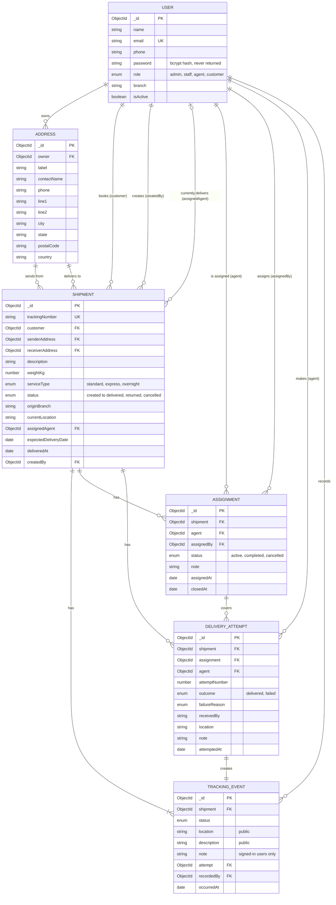
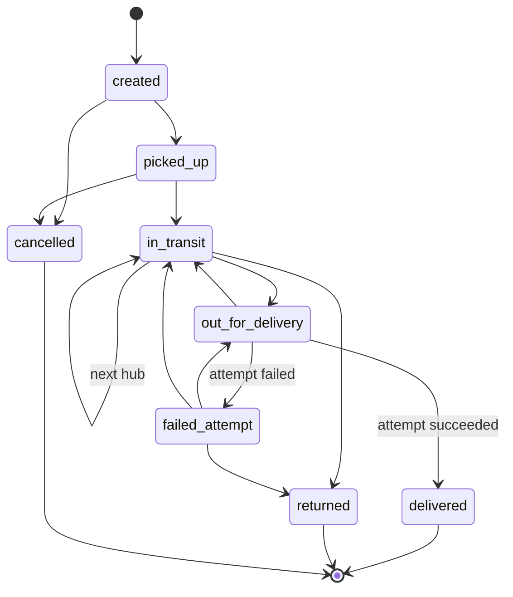

# ER diagram

GitHub draws this diagram automatically. For a picture to submit, paste it into [mermaid.live](https://mermaid.live) and export a PNG.

## Indexes

| Collection | Index | Purpose |
|---|---|---|
| users | `email` (unique) | Login, no duplicate accounts |
| users | `role, isActive, name` | User lists and agent pickers |
| addresses | `owner, createdAt` | A customer's address book |
| addresses | `city, postalCode` | City filter |
| shipments | `trackingNumber` (unique) | Public tracking |
| shipments | `customer, createdAt` | A customer's shipments |
| shipments | `assignedAgent, status` | An agent's deliveries |
| shipments | `status, createdAt` | Status filter and reports |
| shipments | `deliveredAt` | Daily delivered report |
| trackingevents | `shipment, occurredAt` | A shipment's history |
| trackingevents | `status, occurredAt` | Event list filter |
| assignments | `shipment` (unique where status is active) | Only one active agent per shipment |
| assignments | `shipment, assignedAt` | A shipment's assignment history |
| assignments | `agent, status, assignedAt` | An agent's assignments |
| deliveryattempts | `shipment, attemptNumber` (unique) | Attempt numbering |
| deliveryattempts | `agent, attemptedAt` | Agent history and reports |
| deliveryattempts | `outcome, attemptedAt` | Outcome filter and reports |

## Shipment status flow

